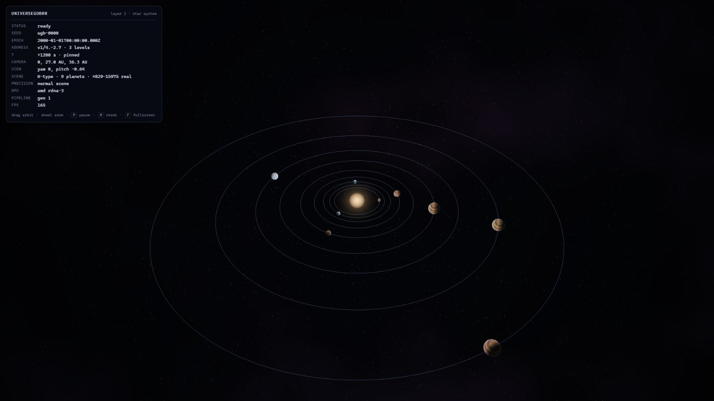
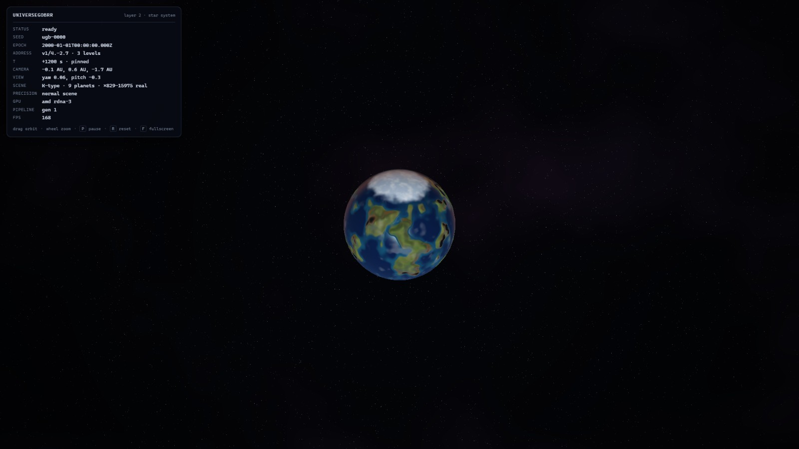

# UniverseGoBrr

A procedural universe explorer for the web: TypeScript, WebGPU, no assets, no server.
This repository is at **Layer 2** of the roadmap in `.scratch/procedural-universe/spec.md` — one
procedural star system. Layer 1 (frames and precision) is complete; there is no travel and no
gameplay yet.





Both frames are `npm run capture` output from this commit, at 1920×1080. Nothing in them is a
texture — the orrery, the rings and every surface are drawn from noise in the fragment stage, and
the only input is `seed` + `addr` + `t`. The panel is the development HUD, and it is in the shots
on purpose: it is where the renderer states its own coordinate, precision path and frame time.

## Run it

Requires Node 22+ and a current Chrome or Edge with WebGPU.

```sh
npm install
npm run dev        # http://127.0.0.1:5173 — open it by hand
```

The dev server never opens a tab and never drifts to another port
(`server.open: false`, `strictPort: true`). One tab, one `GPUDevice`; see
`docs/notes/vite-multiple-tabs.md`.

| Command | What it does |
| --- | --- |
| `npm run dev` | Vite dev server with HMR |
| `npm run build` | Type-check (`tsc --noEmit`) and build to `dist/` |
| `npm test` | Vitest unit tests |
| `npm run capture` | Screenshot every shot in `capture/shots.json` (build first) |
| `npm run verify:dev` | Prove shader HMR, device reuse and no page reload in Chrome |

## The URL is the coordinate

The app reads `seed`, `epoch`, `addr`, `t`, `cam` and an optional debug `precision` from the
query string and writes a canonical version back to the address bar. A pinned `t` makes the
frame reproducible; without it the clock runs from `epoch`.

```
?seed=ugb-0000&epoch=2000-01-01T00:00:00.000Z&addr=v1/0.3.-7.12&t=1200&cam=12,-4,40,0.6,0.15
```

`addr` is the frame: `v1/` then one signed integer per level, top down, with **no fixed
depth** — there is always a bigger region to name, so the universe has no edge. Levels are
identity; display names are presentation **and appear only in the HUD**, never in a link. The
string is meant to read like a coordinate, not like prose (ADR-0008). `v1/` on its own is the
**root**, the frame that contains everything; zooming out drops one level at a time and stops
there, which is why the walk terminates. `cam` is the camera's `x,y,z,yaw,pitch` **inside that
frame** (metres and radians). `t` is seconds since `epoch`. Invalid values are rejected, replaced
by defaults, and listed in the HUD rather than silently accepted; the capture harness fails a shot
whose URL the app rejected, so an image can never quietly show a default coordinate.

`precision=fixed|naive` is a debug switch, not a feature: it draws the precision probe instead
of the starfield, once through the camera-relative path and once through the naive one.

Keyboard: **P** pins/unpins `t` at the current value, **R** resets the camera, **F** toggles
browser fullscreen. The app is desktop-only and full-bleed; mobile is a non-goal.

## Positions never reach the GPU as absolutes

A frame's coordinates can be 10¹³ m from its origin, where a float32 cannot tell a metre from a
kilometre. `src/frame/position.ts` holds a frame origin plus a double-precision local vector,
and the only exported route to the GPU is `toCameraRelativeF32()` — subtract in double
precision, round once afterwards. `toCameraRelativeNaiveF32()` reproduces the old path so the
negative-control capture has something to fail against. See
`docs/adr/0008-camera-relative-and-unbounded-address.md`.

Int64 cells and automatic rebasing are **deferred** to Layer 4, when travel first crosses
frames. They sit behind the same type, so they cost one file when they arrive; the measurement
that justified deferring them is in the ADR.

## One look

There is no light/dark switch and no `prefers-color-scheme` branch. The page is dark because
a universe is dark — the light in a frame is stars, emission nebulae and supernovae, and it
only reads as light against darkness. `index.html` and `src/styles.css` declare
`color-scheme: dark` so browser chrome and form controls stay dark too. See
`docs/adr/0007-single-dark-presentation.md`; `src/look-and-feel.test.ts` fails if a second
look is added back.

## Capture harness

```sh
npm run build
npm run capture
```

Captures run against the built app on a fixed preview port (4173), in installed Chrome,
headless, with a fresh browser context per shot. Shots are 1920×1080, 2560×1440 and
3840×2160 at DPR 1 — 1080p, 1440p and 4K with no OS scaling — plus 1920×1080 at DPR 2 for a
4K display running at 200% scaling (same 3840×2160 physical pixels, double-size UI). Shots pin seed, epoch, `t` and camera, so the image is
reproducible. A shot fails if
the canvas is not full-bleed at that size. The browser context asks for a **light** OS
preference, so a shot also fails if the page follows it. The harness refuses to pass on:

- a shot whose page did not adopt the requested coordinate, or whose URL the app rejected (a
  rejected `addr` or `cam` would silently photograph the default instead);
- a canvas that does not cover the viewport or whose backing store is not CSS size × DPR;
- a page that turns light under a light OS preference (there is no theme system);
- a frame whose GPU readback is blank (`stdev` too low);
- a precision shot that does not reproduce the control: the fixed path must separate the
  markers by at least 100 px with under 50 mm of error, and the naive path must collapse them
  to under 1 px. If the naive shot ever passes with a spread, the harness has stopped detecting
  the bug it exists to detect;
- any console error.

Shot names: `desktop-*` sweep the three desktop widths (plus the DPR-2 shot) over one
coordinate; `layer2-orrery*` are the star-system content shots; `layer1-precision-*` are the
negative control.

The two images at the top of this file are `layer2-orrery` and `layer2-closeup-ocean`, downscaled
to 1600 px wide and saved as JPEG into `docs/media/` — committed so the README renders without a
build, and kept out of `.scratch/` so they survive a change of machine.

Output and a machine-readable summary go to `.scratch/captures/` (gitignored) by default.
`--shot <name>`, `--out <dir>`, `--url <base>` and `--headed` are available.

## The scene: one star system

`src/universe/system.ts` generates a system from `(seed, address)` alone — star class, 3–9
planets, orbital radii, phases, tilts, spin rates — and evaluates positions at `t` in closed
form (`planetPosition`). Periods are real Kepler (`T = 2π√(a³/GM)`), so outer worlds genuinely
orbit slower.

The picture is an **orrery**, and it says so. Two distortions, both reported in the HUD's
`scene` row rather than hidden:

- **Orbit spacing** is `a^0.55`, normalised to the outermost planet. Monotone in the real
  radius, so the order is honest; the ratio is not.
- **Body size** is 1–3% of the frame radius, independent of the body's orbit. A true scale
  would make Earth 0.13 px wide at 1920 px across 2 AU (its radius is 1/23,481 of its orbit).

**Orbit rings are drawn only when the camera is outside them.** A ring is a diagram of the system,
read from outside it: once the eye drops inside an orbit, that ring becomes a wide arc sweeping the
frame — in the ocean close-up seven of them crossed the background and read as scanlines — so the
ring shader fades a ring out as the eye approaches it and hides all rings once the eye is inside the
system (`vs_orbit` in `src/gpu/scene.wgsl`). A ring also fades where it passes over the star's disc,
because rings write no depth and a near-side arc would otherwise cut the photosphere.

`src/render/camera.ts` is the reverse-Z projection and the rotation-only view matrix;
`src/render/system-scene.ts` does the metre → display-unit conversion and the double-precision
camera subtraction. Nothing absolute reaches the GPU.

### Surfaces

Each world has a **class**, and the class is chosen by where it sits, not at random: rock inner,
gas and ice outer, plus `ocean` only in the temperate band (0.7–1.9 AU) where surface water can
exist. The shader draws each class from noise in the fragment stage — no textures, no extra
passes:

| Class | What it looks like |
| --- | --- |
| `rock` | Gentle relief, faint maria, sparse bright crater rims |
| `super-earth` | The same surface at a larger diameter, warmer base |
| `ice` | High albedo with fracture veins |
| `ocean` | Continents, wandering shelf shallows, ice sheets at the poles, drifting cloud layer |
| `gas` | Latitude-locked belts and zones, darker poles, spiral storms with an eye |

This is **identity at orrery scale, not a simulation** (Layer 6 is the real surface pass). The
patterns are tuned for 15–60 px; the noise frequencies were raised once already because at 2–3
cells across a sphere a rock world shaded as one flat gradient.

Four things make them read as worlds rather than as painted spheres, and each is a separate fix
worth keeping:

- **3D noise on the unit direction**, not a 2D projection. `atan2` gave a seam at the 180°
  meridian and `dir.xz` collapsed at the poles; see
  `docs/notes/sphere-surface-projection-seams.md`.
- **Lighting in the planet's local frame** (`to_local` in `scene.wgsl`), so a height gradient can
  perturb the surface normal in the same space the pattern lives in.
- **Relief shading** from one height field shared by albedo and shading, scaled by a per-instance
  `detail` value derived from on-screen radius (full strength at ~42 px; small worlds get only a
  fraction of it). Solid worlds use a deliberately gentle gain — an earlier 1.15 read as a
  crumpled walnut at 9 body radii — while ocean land keeps the stronger one.
- **Class palettes** (`planetColor` in `src/render/system-scene.ts`): gas giants amber to cream,
  ice pale blue, rock rust to grey, ocean blue-green. A random hue across the whole wheel produces
  candy planets — the first pass had a lime-green gas giant.
- **A wider terminator on small worlds.** At orrery scale a 15–20 px body whose sun angle leaves
  most of its disc in night showed only a 4–6 px lit crescent, so the inner planets were findable
  only by hunting. The wrap term widens the day/night edge as the on-screen radius falls
  (`0.14 + 1.25·(1 − detail)²`), which keeps the lit-to-unlit gradient instead of flattening the
  disc with ambient. Close-ups (`detail = 1`) are untouched.

Captures include four close-ups (`layer2-closeup-ocean`, `layer2-closeup-gas`,
`layer2-closeup-rock`, `layer2-closeup-superearth`) so this work is scored, not just asserted.
The non-happy-path states — booting, a rejected URL, live (unpinned) time, and no WebGPU — are
captured by `npm run probe:state`, and the ring fades are stepped across their threshold by
`npm run probe:live`, because the deterministic shot set is all "ready and pinned".

`SYSTEM_VERSION` is **2**: adding the `ocean` class consumed a different sequence of random
draws, so every address generates a different system than it did at version 1. That is what the
version exists for (ADR-0005) — no link was ever shipped, so the break is free now and will not
be later. Shading changes do **not** bump it: it covers structure and state, not appearance.

## Layout

| Path | Role |
| --- | --- |
| `src/main.ts` | `init()` — parse the coordinate, acquire the device, start the app, cache the device through HMR |
| `src/gpu/device.ts` | The one `GPUDevice`, cached on `import.meta.hot.data` |
| `src/gpu/renderer.ts` | Pipeline, frame loop, GPU readback, shader-only HMR boundary |
| `src/gpu/stage0.wgsl` | Layer 1's placeholder starfield and the precision probe; Layer 2 draws over it |
| `src/gpu/scene.wgsl` | Layer 2: the star, orbit rings and every planet surface |
| `src/frame/position.ts` | `Position`, camera-relative float32, and the naive path kept for the control |
| `src/frame/address.ts` | Unbounded versioned address: parse, format, one level deeper |
| `src/frame/precision-probe.ts` | The three-marker scene and its per-path pixel/error report |
| `src/state/url-state.ts` | Pure URL coordinate parser/serializer |
| `src/ui/hud.ts` | Dev HUD and fatal-error panel |
| `tools/capture.mjs` | Capture harness |
| `tools/check-dev-loop.mjs` | HMR/device-reuse proof |

Editing `src/gpu/stage0.wgsl` rebuilds the shader module and pipeline only: the page, the
canvas and the `GPUDevice` survive. A WGSL error keeps the last good pipeline alive and shows
the error in the HUD.

## Not here yet

Layers 3–6 of the spec: the real star fields, travel tiers, nebulae, surfaces.
Int64 cells and automatic rebasing arrive with travel (ADR-0008). The backlog in spec §9 is
captured, not started.